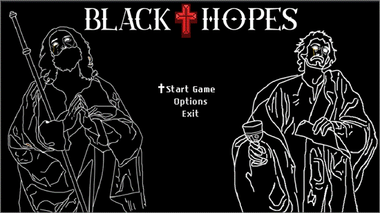
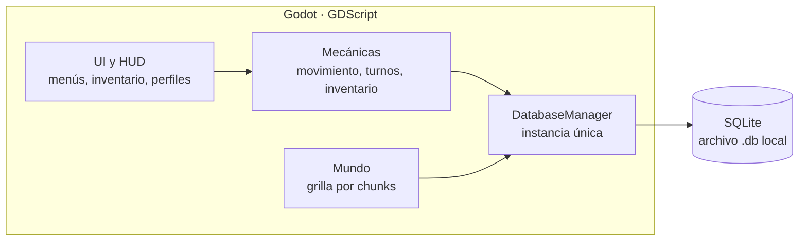
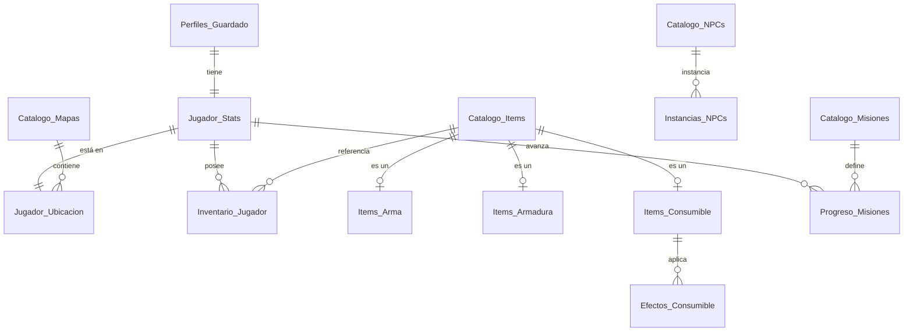
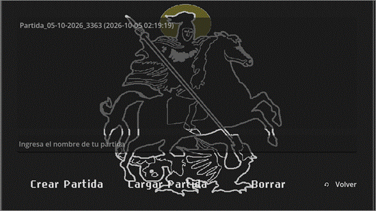
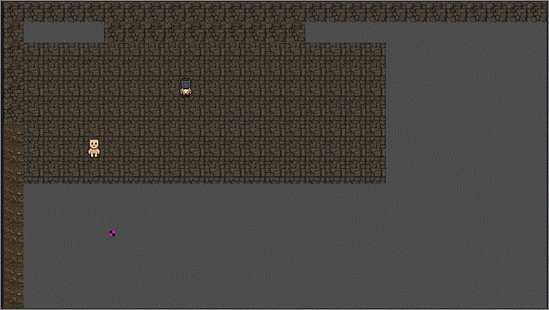
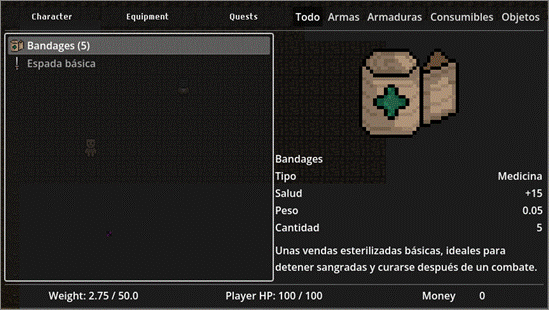
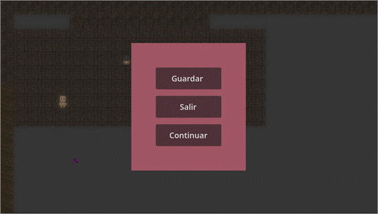
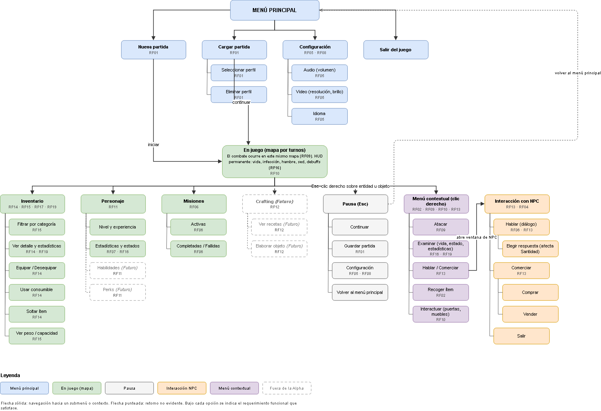

# Black Hopes

**RPG de supervivencia por turnos en cuadrícula**, desarrollado en **Godot (GDScript)** con **SQLite** como núcleo de persistencia.

Proyecto de título · Técnico Universitario en Informática · Universidad Técnica Federico Santa María
Desarrollado por Sergio Aguirre Pardo y Benjamín Nudelman Ruiz · Versión Alpha en desarrollo (2026)

> El código fuente está en un repositorio privado mientras el proyecto está en desarrollo. Aquí se muestra el diseño, la arquitectura y el estado actual.

---

## El juego

Ucronía ambientada en 1492: la peste negra nunca retrocedió y acabó con los reinos de Europa, Asia y África. El jugador es un caballero de la Orden de los Caballeros de Cristo y debe llevar una posible cura a través de un mundo devastado.

- **Movimiento y combate por turnos** sobre una grilla de casillas, donde cada estadística de los ítems influye en el resultado.
- **Supervivencia**: vida, infección, hambre y sed, con estados que penalizan al jugador.
- **Sistema de Santidad**: un medidor moral que cambia precios, diálogos y misiones disponibles.
- **Inventario con peso**: apilar, equipar, consumir y soltar objetos en el mapa.

---

## El problema técnico

Muchos RPG independientes guardan la partida serializando todo en un archivo JSON o XML: leen el archivo completo al iniciar y lo reescriben entero en cada guardado. Esto tiene varios problemas: si el juego se cierra durante la escritura, el archivo se corrompe; un cambio mínimo obliga a reescribir todo; y las relaciones entre los datos no se validan.

**Black Hopes usa una base de datos relacional como eje del juego.** Cada mecánica (inventario, NPCs, misiones, ubicación) lee y escribe en SQLite. Las restricciones del esquema impiden estados inconsistentes, y el diseño contempla transacciones para proteger la partida ante cierres inesperados.

---

## Arquitectura

- **DatabaseManager**: instancia única que inicializa el esquema, activa `PRAGMA foreign_keys` y centraliza las consultas de lectura y escritura del resto del juego.
- **TurnManager**: lleva el reloj de turnos y lo retoma al cargar una partida.
- **LevelManager y chunk_grid**: el mundo se divide en chunks de casillas, que se cargan y descargan según dónde está el jugador para limitar el uso de memoria.
- **Jerarquía de ítems**: una clase base `Item` con subclases (`Weapon`, `Armor`, `Ammo`, `Consumable`) que reflejan la jerarquía de la base de datos.

---

## Modelo de datos

26 tablas en 5 subsistemas. Separa los **catálogos** (datos fijos del juego) del **estado transaccional** (lo que cambia en cada partida).

| Subsistema | Qué guarda |
|---|---|
| Dominios de referencia | Tipos de ítem, ranuras de equipo, tipos de daño, clases de armadura (espejo de los enums de GDScript) |
| Partida y jugador | Perfiles de guardado, estadísticas del personaje, ubicación en chunk y casilla |
| Objetos y posesiones | Catálogo de ítems con especialización ISA (armas, armaduras, munición, consumibles), inventario, ítems en el suelo |
| Entidades y economía | Plantillas de NPC, instancias en el mundo, inventario de mercaderes |
| Entorno y narrativa | Mapas, misiones con requisitos de Santidad, progreso de misiones |

**Integridad**
- Claves foráneas activas (`PRAGMA foreign_keys = ON`) y versión de esquema con `PRAGMA user_version`.
- Restricciones `CHECK` sobre rangos (vida, turnos, coordenadas, durabilidad).
- Especialización de ítems disjunta, impuesta con una clave foránea compuesta `(id_item, tipo)`.
- Los dominios cerrados son tablas, no listas fijas: agregar un tipo nuevo es un `INSERT`, no un `ALTER TABLE`.

---

## Capturas

| | |
|---|---|
|  |  |
| Perfiles de guardado: crear, cargar y eliminar | Mapa en juego con grilla de casillas |
|  |  |
| Inventario con detalle de ítem | Menú de pausa |

### Flujo de menús

---

## Estado del proyecto

**Implementado**
- Capa de base de datos (esquema v2, 26 tablas) y su inicialización
- Movimiento por turnos en grilla, chunks y reloj de turnos
- Inventario: agregar, apilar, equipar, consumir y control de peso
- Ítems en el suelo con persistencia por mapa, chunk y casilla
- Menú principal, perfiles de guardado, menú de pausa e indicador de guardado

**En desarrollo para la Alpha**
- Combate por turnos (daño, perforación y desgaste)
- HUD de estado: vida, infección, hambre, sed
- NPCs, diálogos y sistema de Santidad
- Comercio con mercaderes y registro de misiones

**Después de la Alpha**
- Crafting
- Habilidades y perks

---

## Tecnologías

Godot Engine · GDScript · SQLite · DB Browser for SQLite / DBeaver · Git y GitHub

---

¿Te interesa ver más? Puedo mostrar el código en una entrevista.
Contacto: sergioaguirre.sec@gmail.com
